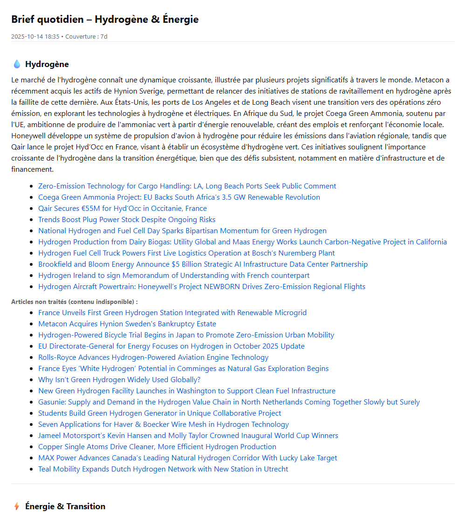

# Actu to me — RSS → LLM daily brief

**EN** · [FR](#fr--version-française)

Turns topic-grouped RSS feeds into a short, readable daily brief: feeds are scoped by keywords, full articles are extracted, then an LLM summarizes them in two passes (per article, then per section) into HTML or plain text.
Runs on demand from the CLI or a small Streamlit UI, over any time window (`--since 24h`, `7d`…).



Full example output: [`docs/example_brief.html`](docs/example_brief.html)

## How it works

```
config/sources.yaml ─► rss_fetcher        fetch feeds per section, dedupe, clean URLs
                    ─► scope_filter       include/exclude keywords (+ optional GPT title filter)
                    ─► content_extractor  full text via newspaper3k / readability / BeautifulSoup
                    ─► article_summarizer V2 pass 1: one summary per article
                    ─► section_synthesizer V2 pass 2: section synthesis + top links
                    ─► renderer           HTML (inline CSS) + text output
```

V1 mode (`summarizer.py`) skips the per-article pass and summarizes each section in a single call.

## Install

Requires Python 3.10+ and an OpenAI API key.

```bash
python -m venv .venv
source .venv/bin/activate          # Windows: .\.venv\Scripts\Activate.ps1
pip install -r requirements.txt
cp config/settings.example.env .env   # Windows: copy config\settings.example.env .env
```

Then set `OPENAI_API_KEY` and `MODEL_NAME` (e.g. `gpt-4o-mini`) in `.env`. Feeds and sections live in `config/sources.yaml`.

## Usage

Always run as a module (`python -m src.main`), not `python src/main.py`.

```bash
# V1 — one-pass section summaries, last 24h
python -m src.main --since 24h --sections hydro energy world --html

# V2 — two-pass summaries over 7 days, with per-article export
python -m src.main --since 7d --v2 --html --export-articles \
  --max-per-section 20 --links-per-section-max 10 --out out/brief_7d.html
```

Main options: `--since`, `--sections`, `--v2`, `--html`, `--out`, `--text-out`, `--export-articles`, `--include-overview`, `--gpt-filter-titles`, `--max-per-section`, `--links-per-section-max`, `--model`. See `python -m src.main --help`.

**Streamlit UI** — edit `.env` and `sources.yaml`, run a brief, send it by email (SMTP):

```bash
streamlit run app.py
```

Quick environment check: `python scripts/self_check.py`.

## Roadmap

- **Robustness** — pytest suite (mocked feed parsing, scope filter, renderer); per-feed network error handling so one dead feed never kills the brief; cache of already-summarized articles to save API calls; GitHub Actions for lint + tests.
- **Next** — LLM provider abstraction (OpenAI / Claude); agent mode exposing `generate_brief` as a tool (function calling); scheduled sending (cron / Task Scheduler); Tech/AI and Defense sections.

## License

MIT — see [LICENSE](LICENSE).

---

## FR — version française

Transforme des flux RSS groupés par thème en un brief quotidien court et lisible : filtrage par mots-clés, extraction du texte intégral, puis résumé par un LLM en deux passes (par article, puis par section), en HTML ou en texte.
Lancement à la demande, en ligne de commande ou via une petite IHM Streamlit, sur la fenêtre de temps voulue (`--since 24h`, `7d`…).

**Pipeline** : `rss_fetcher` (collecte par section) → `scope_filter` (mots-clés include/exclude, filtre GPT optionnel sur les titres) → `content_extractor` (texte intégral) → `article_summarizer` (V2, passe 1) → `section_synthesizer` (V2, passe 2 + liens clés) → `renderer` (HTML + texte). Le mode V1 résume chaque section en un seul appel.

**Installation**

```bash
python -m venv .venv
.\.venv\Scripts\Activate.ps1        # macOS/Linux : source .venv/bin/activate
pip install -r requirements.txt
copy config\settings.example.env .env
```

Renseigner `OPENAI_API_KEY` et `MODEL_NAME` dans `.env`. Les flux et sections se règlent dans `config/sources.yaml`.

**Utilisation**

```bash
python -m src.main --since 24h --sections hydro energy world --html     # V1
python -m src.main --since 7d --v2 --html --export-articles             # V2
streamlit run app.py                                                     # IHM
```

Toujours lancer en module (`python -m src.main`). Vérification rapide de l'environnement : `python scripts/self_check.py`.

**Feuille de route** : tests pytest, gestion d'erreur par flux, cache des résumés, CI GitHub Actions ; puis abstraction du fournisseur LLM (OpenAI / Claude), mode agent (function calling), envoi planifié, sections Tech/IA et Défense.

Licence MIT.
